# Oldworld3

A vibecoded third-person fantasy RPG with real-time, WoW-Classic-style combat in an endless, procedurally generated world.

Author: Emanuel Ahnert and Claude Opus 5.5

## Current State
It is still in early development, with all the balance issues and missing features that come with that.

## Description
You pick one of nine classes and explore a grid of zones that loads around you as you
travel. Enemies roam in packs, call their friends, chase you and give up when dragged too
far. Kill them for XP, money and loot; learn abilities by level; rest at camp fires and
inns; push outward into harder zones.

## Technology
Built with Godot 4.7 (typed GDScript). Every 3D model, texture, animation and sound is
generated by our own pipeline (SDXL + ControlNet + TRELLIS.2 on our own GPU server, Blender
scripts, a synthesizer in Python). No third-party assets.

## Screenshots

<table>
<tr><td width="33%">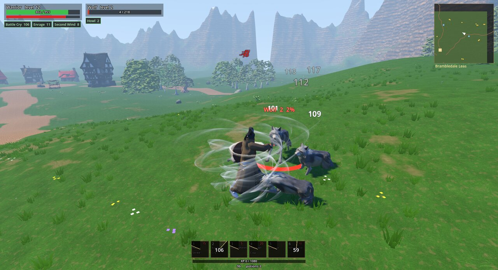 Warrior, level 12: Whirlwind against a wolf pack in the Grassland</td><td width="33%">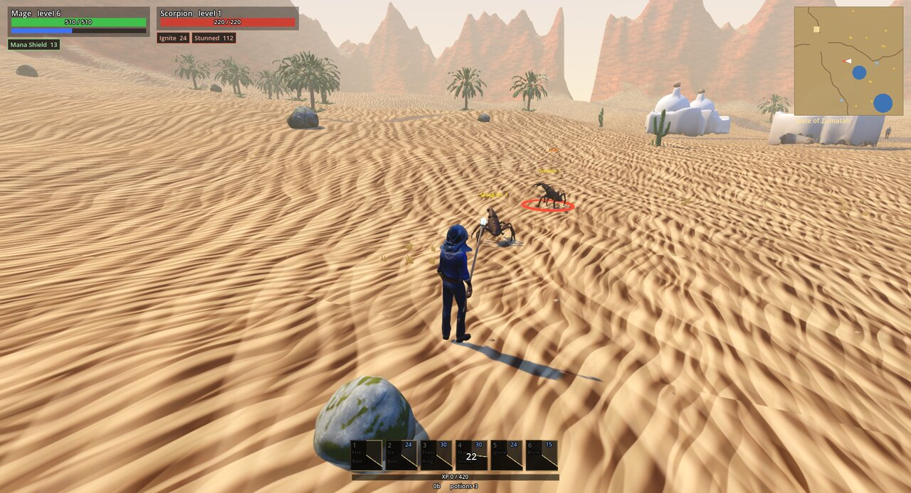 Mage, level 6: Ignite and Mana Shield against scorpions in the Desert</td><td width="33%">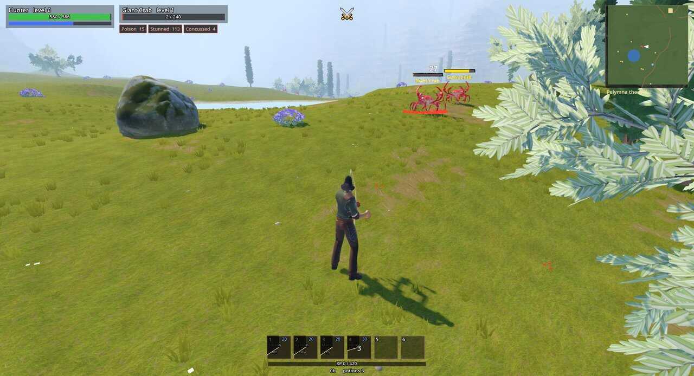 Hunter, level 6: arrows at giant crabs in the Mediterranean</td></tr>
<tr><td width="33%">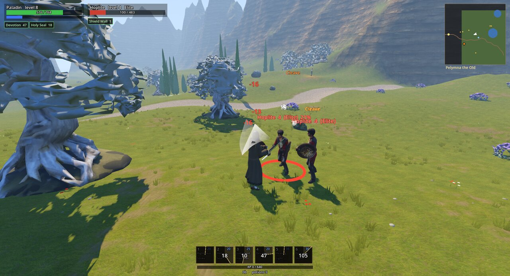 Paladin, level 8: holding off two hoplites in the Mediterranean</td><td width="33%">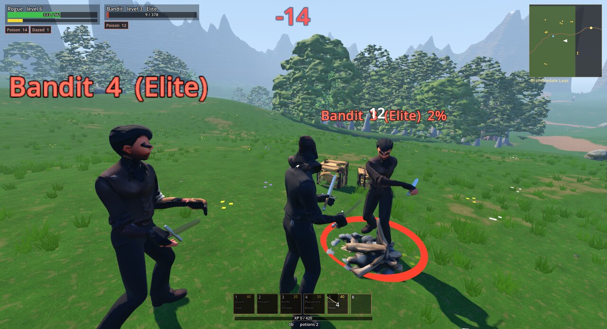 Rogue, level 6: an elite bandit at its camp in the Grassland</td><td width="33%">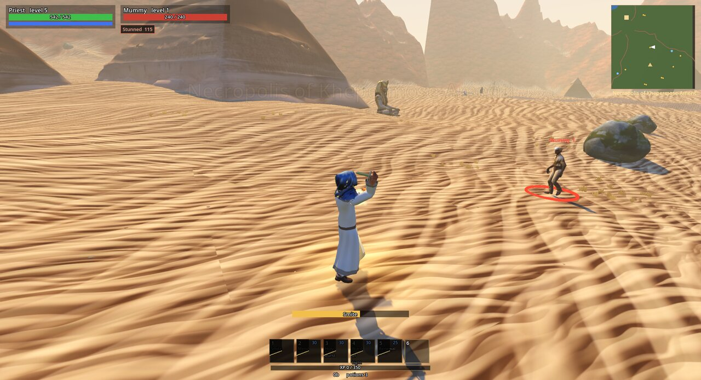 Priest, level 5: Renewal and a shield against a mummy in the Ancient Desert</td></tr>
<tr><td width="33%">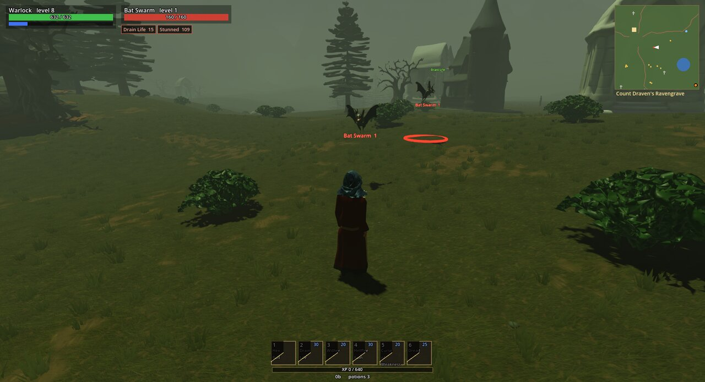 Warlock, level 8: Drain Life on a bat swarm in the Unholy lands</td><td width="33%">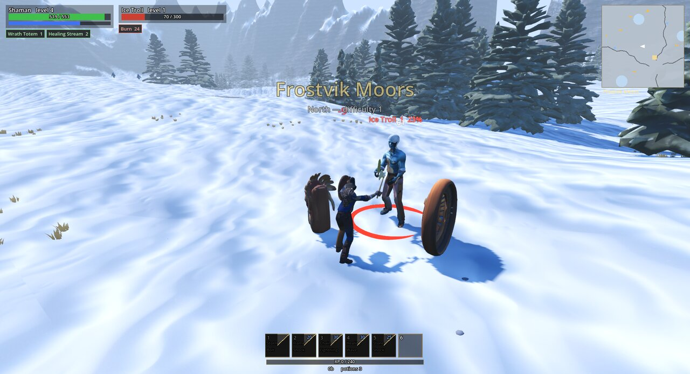 Shaman, level 4: totems down against an ice troll in the North</td><td width="33%">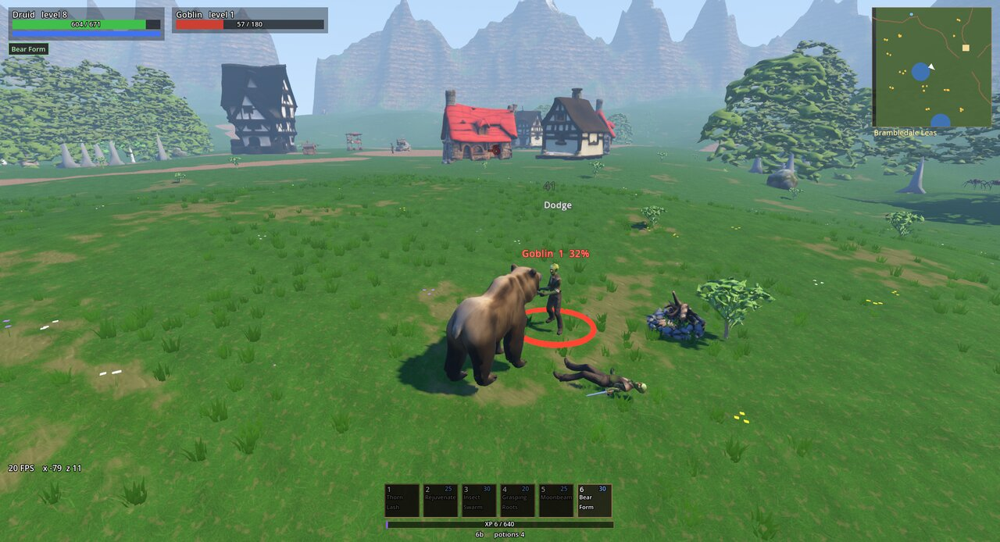 Druid, level 8: Bear Form against a goblin in the Grassland</td></tr>
<tr><td width="33%">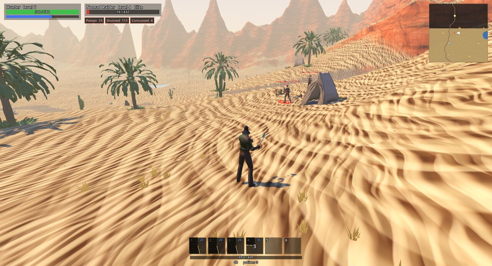 Hunter, level 6: nomad raiders at their camp in the Desert</td><td width="33%">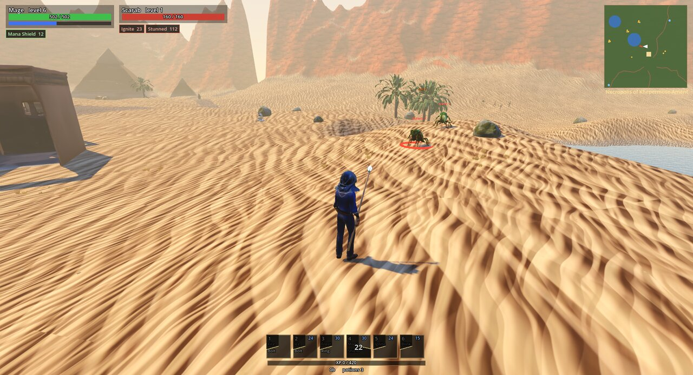 Mage, level 6: scarabs among the pyramids of the Ancient Desert</td><td width="33%">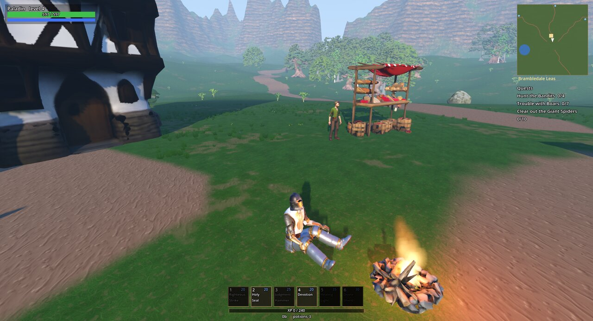 Resting at a camp fire by the inn at dusk</td></tr>
<tr><td width="33%">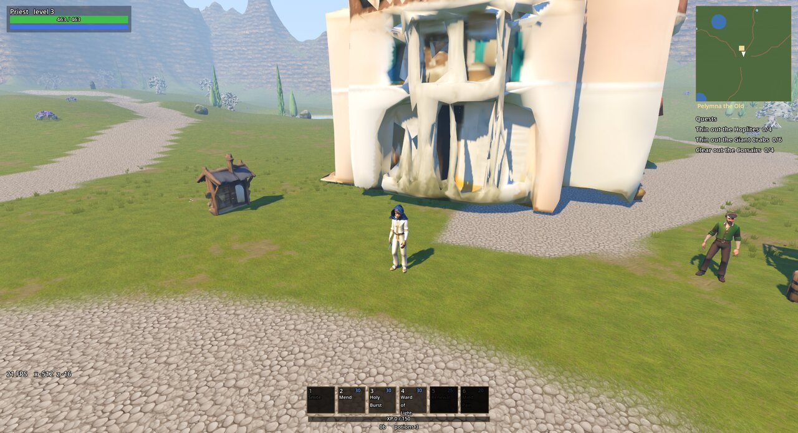 A Mediterranean settlement</td><td width="33%">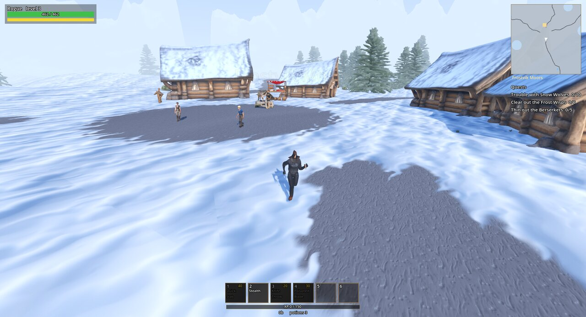 A village in the snow of the North</td><td width="33%">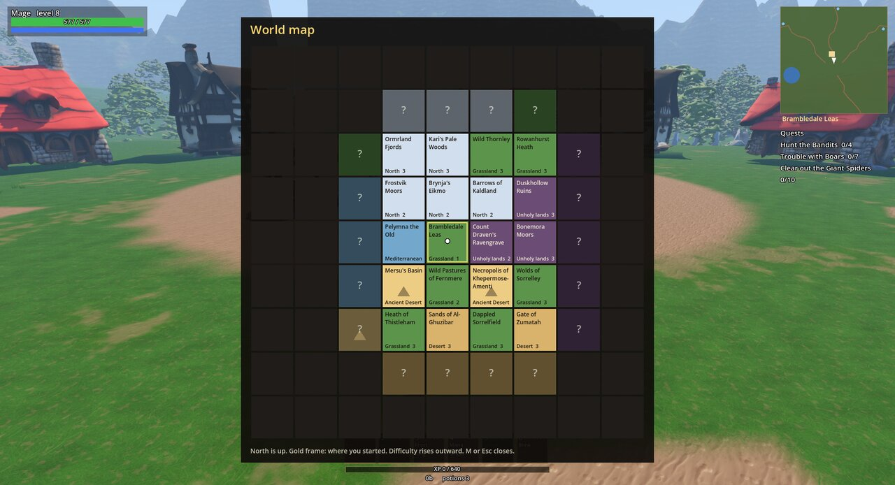 The world map: zones by land and difficulty</td></tr>
</table>

## Features

- **Nine classes:** Warrior, Mage, Rogue, Priest, Paladin, Warlock, Hunter, Shaman and
  Druid, each with its own resource (rage, mana, energy), abilities learned by level and
  passives (6 action slots, 3 passive slots).
- **An endless seeded world** of 512 m zones on a grid, streamed in around you: the
  Grassland at the center, the North, the Desert (Middle Eastern or Ancient), the
  Mediterranean and the Unholy lands around it, each with its own ground, trees, buildings,
  music, names and enemies. Difficulty rises by one per zone outward; roads lead through
  gaps in the cliffs from zone to zone.
- **Real-time combat:** a swing timer, a global cooldown, crits, dodges, elements and types,
  damage and healing over time, slows, stuns and roots, dazes from behind, buffs and
  debuffs on the HUD. Enemies have their own abilities; elites and named champions with
  modifiers.
- **Loot and gear:** generated items by armor type and rarity, worn on the character
  (helms, hoods, plate), potions, a merchant at every inn, quests per zone.
- **Settlements** with an inn (checkpoint, merchant), road shrines, camps, lakes; a camp fire
  to rest anywhere; a day and night cycle; death and respawn at the last checkpoint;
  autosave.

## Download

Ready-to-play builds for Windows and Linux (x86-64) are on the
[Releases page](https://github.com/emanuel-ahnert/oldworld3/releases): a single file each,
with the game data inside. Download it and run it.

- **Windows:** `oldworld3-<version>-windows-x86_64.exe`. Windows may warn that the app is
  from an unknown publisher (it isn't signed): "More info" → "Run anyway".
- **Linux:** `oldworld3-<version>-linux-x86_64`. Downloads lose the "executable" flag, so
  allow it once: `chmod +x oldworld3-*-linux-x86_64` (or Properties → "Allow executing").

`tools/release.sh` builds them.

## Running from source

Needs [Godot 4.7](https://godotengine.org) on the `PATH` as `godot`. The generated assets
are in the repository, so no download is needed.

    tools/run.sh                 # fullscreen (on Hyprland: workspace 9)

or in VS Code: Run and Debug → "Oldworld3 (desktop 9, fullscreen)". The title screen lets
you continue, or start a new game with a class, a start land (any of the six; it becomes
difficulty 1) and a world seed.

Extra arguments go to the game after `--` (see `game/scripts/main.gd`): `--class C`,
`--level N`, `--seed N`, `--start LAND`, `--zone X,Z`, `--quality Low|Medium|High`,
`--fight KIND`, `--gear RARITY`, `--time 0..1`, `--mute` and more.

## Controls

| Input | Action |
|---|---|
| W/S, A/D, Q/E | forward/back, turn (strafe with right mouse held), strafe |
| Space / Shift | jump / sprint (stamina) |
| Left drag / right drag | look around / steer |
| Both mouse buttons | run forward |
| Wheel, - / . | zoom out / in |
| Tab / click / right-click | target the nearest in front / select / attack |
| F | auto-attack |
| 1–6 | abilities |
| R | healing potion |
| B or I / M | bags (and the merchant near an inn) / world map |
| N | abilities menu: 6 active and 3 passive slots |
| C | camp: light a fire and rest |
| Middle mouse | re-center the camera behind the hero |
| F1 | hide the controls |
| Esc | clear the target, then the menu (graphics quality, save, quit) |

## Development

    tools/shot.sh out.png 200 --class hunter --fight crab   # scripted run, saves a screenshot
    tools/bench.sh                                          # frame-rate benchmark
    tools/screenshots.sh                                    # retakes the screenshots above

Test runs open on a hidden Hyprland workspace and never take the focus.

Everything in the game is made by scripts in this repository:

- **Characters, creatures, gear and scenery:** generated on our gen3D server (SDXL with
  ControlNet for the images, TRELLIS.2 for the meshes), then rigged, fitted and textured by
  Blender scripts in `tools/pipeline/` (`tools/build_characters.sh`,
  `tools/build_creatures.sh`). The prompts, seeds and jobs are in `game_src/manifest.json`.
- **Animations:** text-to-motion on the same server, retargeted to our skeleton.
- **Terrain, buildings, effects:** built in code (heightmaps, shaders, procedural meshes).
- **Music and sound effects:** synthesized by `tools/audio/makeaudio.py` (oscillators,
  noise, filters, a small composer).

## Project Layout

| Path | Contents |
|------|----------|
| `game/` | The Godot project |
| `game/scripts/player` | The hero: classes, abilities, input, the camera |
| `game/scripts/combat` | Damage rules, combat stats, projectiles |
| `game/scripts/enemies` | Enemy kinds, behavior, creature animation |
| `game/scripts/character` | Humanoid bodies: gear on the skeleton, the animation tree |
| `game/scripts/world` | Zones, terrain, scatter, settlements, spawning, day and night |
| `game/scripts/items` | Items, loot and quests |
| `game/scripts/ui` | HUD, minimap, world map, bags, abilities menu, title, menu |
| `game/shaders` | Terrain, water, body slots, armor, effects |
| `design/` | The design documents, starting with [game-design.md](design/game-design.md); [nightlog.md](design/nightlog.md) lists what was built when |
| `tools/` | The asset pipeline, audio, test runner, benchmark and screenshot scripts |
| `game_src/` | Generated sources (`raw/`), batch scripts, `manifest.json` |
| `docs/screenshots` | The screenshots above |
